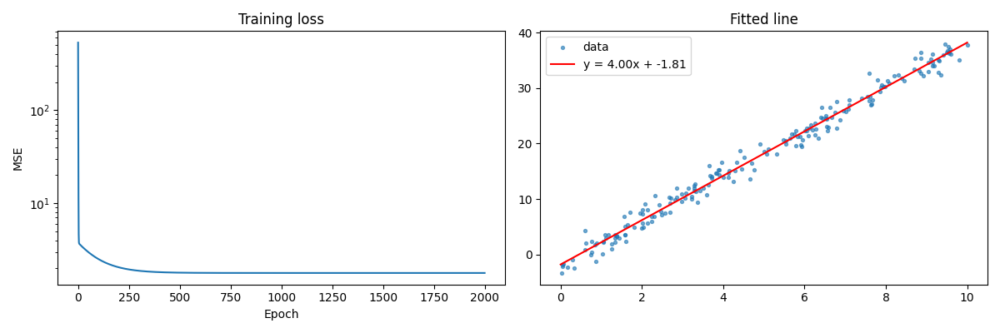

# Deep Learning Labs

Three lab notebooks: the maths behind deep learning, linear regression and maximum likelihood, and a convolutional neural network for image classification.

## Coursework

Labs for **Deep Learning**, Semester 5 (Autumn 2025), Plaksha University.

## Labs and results

| Lab | Notebook | Topic | Result |
|---|---|---|---|
| 1 | `lab01_math_for_dl.ipynb` | Derivatives, gradients, the chain rule and backpropagation through a single neuron, the Jacobian, probability (law of large numbers, Bayes' rule, marginal and conditional probability, expectation and variance) | f'(2) = 4 for f(x) = x^3 - 2x^2 + 5, confirmed by a finite-difference check. Coin-flip estimate of P(heads) goes from 0.3 (10 flips) to 0.499 (1,000,000 flips) |
| 2 | `lab02_regression_and_mle.ipynb` | Linear regression with the normal equation in NumPy, a PyTorch tutorial (tensors, autograd), my own PyTorch regression model, maximum likelihood for Gaussian and Bernoulli data | Normal equation: intercept 4.99, slope 1.97 (true 5 and 2). PyTorch model: slope 4.001, intercept -1.807 (true 4 and -2). Gaussian MLE: mean 9.42, standard deviation 3.74. Bernoulli MLE: p = 0.70 |
| 3 | `lab03_cnn_cifar10.ipynb` | CNN in PyTorch on CIFAR-10 (10 classes of 32 x 32 colour images): three convolution blocks, cross-entropy loss, Adam, a training-loss plot and accuracy per class | The notebook is complete but is saved **without outputs**: training was not rerun for this upload. Running it downloads CIFAR-10 into `data/` and trains for 10 epochs (roughly 15-20 minutes on a CPU) |



*Lab 2: the PyTorch regression model's fitted line and its training loss.*

## How to run

```
pip install -r requirements.txt
jupyter notebook
```

## Notes on the cleanup

- **Lab 1:** the derivative exercise used a different function from the one in the question. It now uses f(x) = x^3 - 2x^2 + 5 and checks the result with a finite difference.
- **Lab 2:**
  - `a.mean()` on an integer tensor crashed; the tensor is now converted to float first;
  - my own PyTorch regression model and the maximum-likelihood exercises were unfinished and are now completed.
- **Lab 3:**
  - DataLoader workers are set to 0 so it runs on Windows;
  - added the training-loss plot, the accuracy per class and the answers to the questions on loss functions and optimisers.
